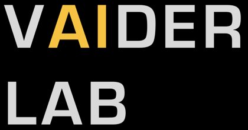

# Film Dosimetry Workbench: Quick Guide

Open `film-dosimetry.html` in Chrome, Safari or Firefox (double-click). Everything runs locally; nothing is uploaded.

## 1. Calibrate
1. Pick the layout: **One scan, many pieces** or **One image per dose**.
2. Open the scan (or add the images). Per-dose images read the dose from the file name (e.g. `3Gy`, `0p5Gy`); otherwise type it in the table.
3. One scan: click each film piece (Patch) or drag a box (Rectangle), then type its dose. Include a 0 Gy piece.
   **Control (0 Gy):** press **Add control (0 Gy)...** in the Calibration points panel and pick the scan of an unirradiated film (works in either layout; several allowed). It is sampled with a central ROI and entered as 0 Gy. Click its row to view it and click in the image to move the ROI. In per-dose mode, files named like `control`, `ctrl`, `unirradiated` or `blank` are treated as 0 Gy controls automatically.
4. Keep **Blue-channel renormalization** on (default) to use x = (channel - blue)/max.
5. Check the fit: R² near 1, small RMSE, residuals (Δ) near 0. Remove or fix bad points.
6. **Save calibration (.json)** next to your scans.

## 2. Dose map and export
1. Open the film scan. It is auto-straightened and cropped to the film (against the white scanner background) on open. To adjust: type a **Rotation**, nudge it, use **Level edge** (drag along any edge that should be horizontal or vertical), or draw the **Export region** by hand. **Reset** returns to the original scan; **Edge inset** trims the film rim.
2. Load a calibration (.json) or use the one just fitted.
3. Set channel weights (default 100% green), binning (4 = ~0.34 mm at 300 dpi), dpi and clip dose. Press **Convert to dose**.
4. Use **Measure** to read mean ± SD dose in a box.
5. Export: **TIFF 32-bit** (dose in Gy), TIFF 16-bit, or **DICOM RTDOSE**.

## 3. Compare with a dose distribution (RTDOSE)
1. Convert a film on tab 2, then on tab 3 **Open RTDOSE** (uncompressed DICOM; grids aligned to the patient axes, including 90°-rotated ones such as image orientation 0,1,0,-1,0,0; tilted grids are not supported).
2. Pick the plane (Coronal y, Axial z or Sagittal x) and set it with the x, y, z sliders. The two other sliders (or a click in a view) put the film centre in that plane. Rotate and flip the film in the **Film placement** panel.
3. Beside the profile plot (Results panel) are the placement controls:
   - **Arrow pad** moves the film over the dose (hold to repeat; step size and X/Y mm boxes). Orange = horizontal, cyan = vertical, matching the profile lines drawn on the maps. The maps and profiles update live; gamma is recalculated when you press Compare.
   - **Auto-align** finds the best film position by correlation (optionally rotation and flips).
   - **Optimize shift** searches the (x, y) shift that minimizes the total dose difference (sum of |film − RTDOSE|, or sum of squares) over the film pixels above the threshold. It starts from the current shift; run Auto-align first if the film is far off. **Undo** restores the previous shift. It optimizes position only, so a good fit does not show the dose scale is right.
4. Choose normalization (none, maximum, mean of high-dose pixels at x % of max, or a point: click a map), the low-dose threshold (default 10 %), and gamma (% and mm, global or local).
   - **ROI to analyze** (Compare tab, right column) limits the comparison to part of the film. **All** uses the whole image. **Select ROI** lets you drag a rectangle (or ellipse) on any map. **Inside Well-48** masks the film to a circle 1 mm inside each well of a Corning-style 48-well plate (6 rows A–F by 8 columns 1–8; pitch 13.08 mm and bottom diameter 11.05 mm by default, editable). Drag a map to move the plate, or type its centre and rotation. Normalization, threshold, statistics, gamma, profiles and **Optimize shift** all use the masked pixels only. In Inside Well-48 mode a per-well table (film − RTDOSE, % difference, ratio, means) appears under the results, with a **Wells (.csv)** export. Set the threshold to 0 to include unirradiated wells in the global statistics.
5. **Compare** gives the film, RTDOSE, difference and gamma maps, a profile, and a report (mean, SD, RMS, percent within 1/2/3/5 %, gamma pass rate). **Export report (.txt)** saves it with the profile; tick "include every pixel" for a per-pixel table.

## Tips
- **Scan the calibration strip, the 0 Gy (BKG) strip and the sample films together in one scan.** Separate scans of the same films differed by about 20-28 counts in overall brightness and by about a factor of two in the calibration contrast, which gave 20-35 % dose errors against the Eclipse RTDOSE. With everything in one scan the film agreed with RTDOSE within about 5 %. Scan at 48-bit if possible.
- Scan all films the same way (Epson 12000XL, 300 dpi, same position, Epson Scan 2 corrections off). See `02_TEMPLATES/readme_scanning_films.txt`.
- Use one calibration per film lot, scanner and scan delay.
- Doses beyond your highest calibration point are extrapolated; keep films within the calibrated range. Add steps above your highest analysed dose (for example 25-30 Gy) so the curve is anchored there.
- Scroll to zoom, hold Space to pan. The export saves `.tif`/`.dcm` directly when the file is opened from disk; the web-hosted version delivers them in a .zip.
- DICOM is for research use only; it is not tied to a treatment plan.

## Citation
Scholl et al. A method for embedding cells on radiochromic film for in vitro high-precision radiation dosimetry. Medical Physics, 2025. doi:10.1002/mp.18004

---
VAIDER Lab (Veterinary AI in Diagnostic Imaging and Radiotherapy), [vaiderlab.org](https://www.vaiderlab.org)
