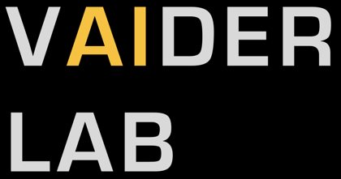

# Film Dosimetry Workbench

**[Launch the app](https://pbasran.github.io/FilmDosimetryWorkBench/)** (GitHub Pages). A single-file, browser-based tool for radiochromic film dosimetry (VAIDER Lab). Everything runs locally in the browser; scans are never uploaded.

**Open `index.html` (a launcher page with a Launch button) or `film-dosimetry.html` directly, in Chrome, Safari or Firefox.** TIFF scans are read with UTIF.js, which is loaded from a CDN, so the first TIFF load needs an internet connection (JPEG and PNG scans do not).

## What it does
1. **Calibrate:** fit dose = A / (x + C) + B per channel from film pieces of known dose, with blue-channel renormalization, x = (channel − blue) / max. Save and load calibrations as JSON.
2. **Dose map and export:** straighten and crop a scan, convert to dose, and export 32-bit TIFF (Gy), 16-bit TIFF or a DICOM RTDOSE.
3. **Compare:** overlay a film dose map on a DICOM RTDOSE (axis-aligned grids, including 90°-rotated ones), with live shift controls, auto-align, shift optimization, profiles, difference and gamma maps, and a report.

See [HOW_TO.md](HOW_TO.md) for the workflow.

## Scanning advice
Scan the calibration strip, the 0 Gy background strip and the sample films together in a single scan, with scanner colour corrections off (48-bit if available). Separate scans of the same films gave 20–35 % dose differences against the treatment planning system; with everything in one scan the agreement was within about 5 %.

## Citation
The film calibration approach used here is described in:

> Scholl et al. **A method for embedding cells on radiochromic film for in vitro high-precision radiation dosimetry.** *Medical Physics*, 2025. [doi:10.1002/mp.18004](https://doi.org/10.1002/mp.18004) · [PMC12340475](https://pmc.ncbi.nlm.nih.gov/articles/PMC12340475/)

If you use this software, please cite that paper.

## Status
Research use only. DICOM export is not tied to a treatment plan.

## License
MIT, see [LICENSE](LICENSE).
